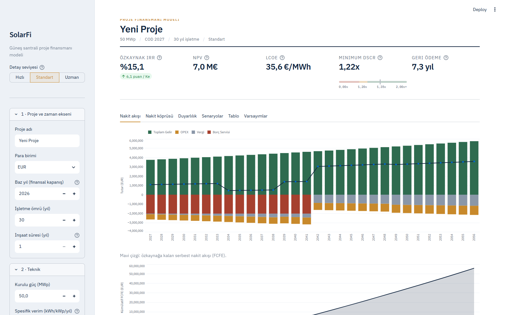

# SolarFi

A project-finance model for utility-scale solar PV, with a Streamlit front end.

Most open-source solar calculators stop at "revenue minus cost." This one models the
things that actually decide whether a plant gets built: a construction period with
capitalised interest, a real debt schedule with **DSCR**, tax loss carryforward,
turnover-based land rent, and P50/P90 production scenarios.

> **Not investment advice.** This is an educational and pre-feasibility tool. The
> bundled price curves are **synthetic** and represent no real market view.



---

## What it does

| Area | What's modelled |
|---|---|
| **Timeline** | Multi-year construction with a custom spend schedule; COD; operating life |
| **Revenue** | Merchant price curve or flat price, capture rate, PPA/auction contracts, Agri-PV, storage arbitrage |
| **Costs** | Unit or lump-sum CAPEX with contingency; fixed / per-MWp / per-MWh OPEX; land rent; **inverter replacement** funded through a maintenance reserve account |
| **Land rent** | Simple escalating base, or `max(base rent, % of turnover)` |
| **Debt** | Pro-rata drawdown, upfront fee, interest during construction (capitalised or cash-paid), and a choice of **fixed gearing** or **DSCR-sculpted sizing** where leverage is an output, not an input |
| **Tax** | Straight-line depreciation excluding land, interest tax shield, loss carryforward with optional expiry |
| **End of life** | Decommissioning cost and salvage value |
| **Outputs** | Equity IRR, NPV, LCOE, min/average DSCR, payback, CO₂ avoided |
| **Risk** | Tornado sensitivity, scenario table (Base/High/Low/P90/stress), two-way sensitivity grid |
| **Output** | Three-sheet Excel workbook with **live formulas** — change the discount rate and NPV recalculates |

---

## Quick start

```bash
git clone https://github.com/idrishannn/solarfi.git
cd solarfi
python -m venv .venv && source .venv/bin/activate   # Windows: .venv\Scripts\activate
pip install -r requirements.txt
streamlit run app.py
```

### Use the engine without the UI

The engine is a plain Python package with no Streamlit dependency:

```python
from solarfi import ProjectInputs, run_model

inputs = ProjectInputs(
    project_name="Puglia 50 MWp",
    capacity_mwp=50,
    specific_yield=1_650,
    flat_price=45.0,
    debt_ratio=0.70,
    interest_rate=0.065,
    loan_tenor=15,
)

result = run_model(inputs)
print(f"Equity IRR : {result.equity_irr:.2%}")
print(f"Min DSCR   : {result.min_dscr:.2f}x")
print(f"LCOE       : {result.lcoe:.1f} {inputs.currency}/MWh")

result.to_dataframe().to_csv("cashflow.csv", index=False)
```

See [`examples/quickstart.py`](examples/quickstart.py) for a fuller walkthrough.

---

## Bring your own price data

**No commercial price data ships with this repository.** Licensed forecasts (AFRY/Pöyry,
Aurora, BNEF and similar) cannot be redistributed, so `data/` contains synthetic curves
generated by a documented formula in `solarfi/data_loader.py`.

To use real data, drop a CSV into `data/` shaped like this:

```csv
Year,North,Centre,South
2026,78.4,77.9,76.1
2027,76.2,75.4,74.0
```

The app picks it up automatically, or you can upload it from the sidebar. Years beyond
the end of the curve are extrapolated with the escalation rate you set.

---

## Project layout

```
solarfi/
├── app.py                  # Streamlit UI — no financial logic lives here
├── solarfi/
│   ├── inputs.py           # ProjectInputs dataclass + validation
│   ├── engine.py           # the model
│   ├── finance.py          # NPV / IRR / PMT / payback
│   ├── sensitivity.py      # tornado, scenarios, two-way tables
│   ├── data_loader.py      # price-curve CSV loading + synthetic generator
│   ├── export.py           # four-sheet Excel workbook with live formulas and charts
│   └── theme.py            # palette, Turkish number formatting, chart styling
├── data/                   # synthetic sample curves (replace with your own)
├── tests/                  # 337 tests, 94% coverage
├── docs/METHODOLOGY.md     # formulas, conventions, known limitations
└── examples/quickstart.py
```

The split matters: `run_model()` is a pure function of `ProjectInputs`, so the same
engine backs the UI, the tests, and any batch script you write.

---

## Excel output

The download is a four-sheet workbook — Özet (summary), Nakit Akışı (cash flow),
Grafikler (charts), Varsayımlar (assumptions) — and it is **not a dead dump of numbers**. Derived rows
(revenue, EBITDA, CFADS, DSCR, FCFE, cumulative) and every headline metric are real Excel
formulas. Change the cost of equity on the summary sheet and NPV recalculates; LCOE
correctly does not move, because it discounts at WACC.

The charts are native Excel chart objects bound to the cash-flow cells, not images, so
they redraw when a value changes. A second, smaller download gives the cash flow alone as a
single sheet of plain values — formulas with external references break when pasted into
someone else's model.

Formatting follows standard financial-model convention: blue for inputs, black for
formulas, green for cross-sheet links, yellow for key assumptions; negatives in
parentheses, zeros as dashes, percentages stored as fractions, years as text.

Driver rows (generation, price, OPEX, tax, debt service) are written as values. That is
deliberate and stated in the file: loss carryforward, turnover-based rent and
DSCR-sculpted debt cannot be expressed in closed form as spreadsheet formulas. The
workbook is a report of a computed scenario, not the engine rewritten in Excel — which is
why the assumptions sheet exists.

The test suite proves this rather than asserting it: it recalculates the workbook with
LibreOffice and checks every computed figure against the engine, including a test that
edits the discount rate and confirms the new NPV matches a fresh engine run.

---

## Testing

```bash
pip install -r requirements-dev.txt
pytest                  # everything (~30s)
pytest -m "not ui"      # engine only, sub-second
```

**Engine tests check numbers, not just that code runs.** Annuities are compared against
closed-form values, IRR is verified by confirming NPV is zero at that rate, LCOE is
recomputed by hand, and identities like `CFADS = EBITDA − tax` are asserted for every period.
The `finance` module is cross-checked against `numpy-financial` to 8 decimal places.

**UI tests actually run the app** via Streamlit's `AppTest`, headless. Every mode and every
optional toggle is exercised, because the easiest bug to ship in a Streamlit app is a
variable that only goes undefined inside one rarely-opened branch.

---

## Conventions worth knowing

- **Everything is nominal.** Cash flows include inflation; discount rates must too.
- **Period 0 is not discounted.** `cashflows[i]` is discounted by `(1 + r) ** i`.
- **FCFE is discounted at cost of equity, not WACC.** WACC appears only in LCOE.
- **Percentages are stored as decimals.** 7.5% is `0.075`. The UI converts; the engine never guesses.
- **Costs are negative** in every output series, so a period's net is a plain sum.

Full derivations and known limitations are in [`docs/METHODOLOGY.md`](docs/METHODOLOGY.md).

---

## Debt sculpting

Most open-source models size debt as a fixed percentage of CAPEX and repay it with a level
annuity. Real project finance works the other way round: the lender fixes a minimum DSCR,
the repayment profile is **sculpted** to hold that ratio in every period, and the loan
amount falls out as the present value of those payments.

```python
from solarfi import DebtSizing, ProjectInputs, run_model

inputs = ProjectInputs(
    debt_sizing=DebtSizing.SCULPTED_DSCR,
    target_dscr=1.45,
    max_gearing=0.85,
)
result = run_model(inputs)
result.effective_gearing   # an output — 79.6%
result.min_dscr            # 1.45x, flat across every year of the tenor
```

Because CFADS depends on tax, tax depends on interest, and interest depends on the loan
amount, this is circular and is solved by fixed-point iteration (typically 5–7 passes).
On the default project, sculpting carries €0.75M more debt at the *same* minimum DSCR and
lifts equity IRR by 0.8 points — that gap is the capacity a level annuity throws away.

---

## Roadmap

- [ ] Semi-annual periods (real deals size debt on six-monthly DSCR)
- [ ] Capture rate that erodes as solar penetration rises
- [ ] First-year LID degradation separate from the steady-state rate
- [ ] Monte Carlo simulation over price, yield and CAPEX
- [ ] Hourly capture-rate modelling instead of a single annual factor
- [ ] Merchant tail after PPA expiry with separate price assumptions
- [ ] DSRA (debt service reserve account) and cash sweep

---

## Licence

MIT — see [LICENSE](LICENSE).

Türkçe açıklama için: [README.tr.md](README.tr.md)
