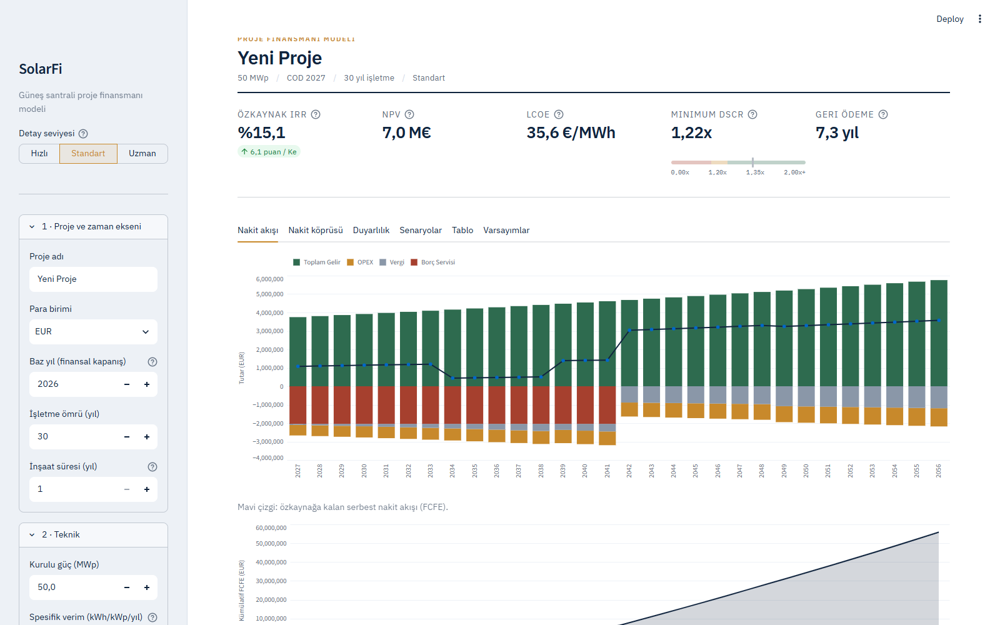

# SolarFi

Büyük ölçekli güneş santralleri için proje finansmanı modeli ve Streamlit arayüzü.

Açık kaynak güneş hesaplayıcılarının çoğu "gelir eksi gider" seviyesinde kalır. Bu model
bir santralin gerçekten yapılıp yapılmayacağını belirleyen kalemleri de içeriyor:
kapitalize faizli inşaat dönemi, **DSCR**'lı gerçek bir kredi planı, zarar mahsubu,
ciro payına bağlı arazi kirası ve P50/P90 üretim senaryoları.

> **Yatırım tavsiyesi değildir.** Eğitim ve ön fizibilite amaçlıdır. Depoda gelen
> fiyat eğrileri **sentetiktir** ve hiçbir gerçek piyasa görüşünü temsil etmez.



---

## Neleri modelliyor

| Alan | Kapsam |
|---|---|
| **Zaman ekseni** | Çok yıllı inşaat, özel harcama takvimi, COD, işletme ömrü |
| **Gelir** | Fiyat eğrisi veya sabit fiyat, yakalama oranı, ihale/PPA, Agri-PV, depolama arbitrajı |
| **Maliyet** | Birim veya toplam CAPEX + beklenmeyen gider payı; sabit / MWp / MWh bazlı OPEX; **invertör yenileme** ve bakım rezerv hesabı |
| **Arazi kirası** | Endeksli baz kira veya `max(baz kira, ciro payı)` |
| **Kredi** | Oransal kullandırım, komisyon, inşaat dönemi faizi (IDC), ve **sabit kaldıraç** ya da **DSCR'a göre şekillendirme** (sculpting) seçeneği — ikincisinde kaldıraç girdi değil çıktıdır |
| **Vergi** | Arazi hariç doğrusal amortisman, faiz vergi kalkanı, süreli/süresiz zarar mahsubu |
| **Ömür sonu** | Söküm maliyeti ve hurda değeri |
| **Çıktılar** | Özkaynak IRR, NPV, LCOE, min./ort. DSCR, geri ödeme, önlenen CO₂ |
| **Risk** | Tornado analizi, senaryo tablosu (Baz/Yüksek/Düşük/P90/stres), iki boyutlu duyarlılık |
| **Çıktı** | Üç sekmeli, **canlı formüllü** Excel raporu — iskonto oranını değiştirin, NPV yeniden hesaplansın |

---

## Hızlı başlangıç

```bash
git clone https://github.com/<kullanici-adin>/solarfi.git
cd solarfi
python -m venv .venv && source .venv/bin/activate   # Windows: .venv\Scripts\activate
pip install -r requirements.txt
streamlit run app.py
```

### Arayüzsüz kullanım

Motor saf bir Python paketidir; Streamlit'e bağımlı değildir:

```python
from solarfi import ProjectInputs, run_model

girdi = ProjectInputs(
    project_name="Konya 50 MWp",
    capacity_mwp=50,
    specific_yield=1_750,
    flat_price=45.0,
    debt_ratio=0.70,
    interest_rate=0.065,
    loan_tenor=15,
)

sonuc = run_model(girdi)
print(f"Özkaynak IRR : {sonuc.equity_irr:.2%}")
print(f"Min. DSCR    : {sonuc.min_dscr:.2f}x")
print(f"LCOE         : {sonuc.lcoe:.1f} {girdi.currency}/MWh")

sonuc.to_dataframe().to_csv("nakit_akisi.csv", index=False)
```

---

## Kendi fiyat verini kullan

**Depoda hiçbir ticari fiyat verisi yoktur.** Lisanslı tahminler (AFRY/Pöyry, Aurora,
BNEF vb.) yeniden dağıtılamaz; bu yüzden `data/` klasöründe `solarfi/data_loader.py`
içindeki belgelenmiş bir formülle üretilmiş sentetik eğriler bulunur.

Gerçek veri için `data/` klasörüne şu formatta bir CSV koyman yeterli:

```csv
Year,Kuzey,Merkez,Güney
2026,78.4,77.9,76.1
2027,76.2,75.4,74.0
```

Uygulama dosyayı otomatik algılar; dilersen kenar çubuğundan da yükleyebilirsin.
Eğrinin bittiği yıldan sonrası, girdiğin eskalasyon oranıyla uzatılır.

---

## Proje yapısı

```
solarfi/
├── app.py                  # Streamlit arayüzü — burada finansal hesap YOK
├── solarfi/
│   ├── inputs.py           # ProjectInputs dataclass'ı + doğrulama
│   ├── engine.py           # modelin kendisi
│   ├── finance.py          # NPV / IRR / PMT / geri ödeme
│   ├── sensitivity.py      # tornado, senaryolar, iki boyutlu tablolar
│   ├── data_loader.py      # fiyat eğrisi CSV okuma + sentetik üreteç
│   ├── export.py           # canlı formüllü, grafikli dört sekmeli Excel raporu
│   └── theme.py            # palet, Türkçe sayı biçimlendirme, grafik stili
├── data/                   # sentetik örnek eğriler (kendi verinle değiştir)
├── tests/                  # 337 test, %94 kapsam
├── docs/METHODOLOGY.md     # formüller, konvansiyonlar, bilinen sınırlar
└── examples/quickstart.py
```

Bu ayrım önemli: `run_model()` sadece `ProjectInputs`'e bağlı saf bir fonksiyondur,
dolayısıyla aynı motor hem arayüzü hem testleri hem de yazacağın toplu betikleri besler.

---

## Excel çıktısı

İndirilen dosya dört sekmelidir — Özet, Nakit Akışı, Grafikler, Varsayımlar — ve **ölü bir
sayı dökümü değildir**. Türetilmiş satırlar (gelir, EBITDA, CFADS, DSCR, FCFE, kümülatif) ve
bütün göstergeler gerçek Excel formülüdür. Özet sekmesindeki özkaynak maliyetini
değiştirin, NPV yeniden hesaplanır; LCOE ise doğru şekilde değişmez, çünkü o WACC ile
iskonto edilir.

Grafikler resim değil, nakit akışı hücrelerine bağlı yerel Excel grafik nesneleridir; bir
değer değişince yeniden çizilirler. İkinci ve küçük bir indirme, nakit akışını tek sayfa düz
değer olarak verir — dış referanslı formüller başka bir modele yapıştırıldığında kırılır.

Biçimlendirme standart finansal model konvansiyonunu izler: girdiler mavi, formüller
siyah, sekmeler arası bağlantılar yeşil, kilit varsayımlar sarı; negatifler parantezli,
sıfırlar tire, yüzdeler kesir olarak saklı, yıllar metin.

Sürücü satırlar (üretim, fiyat, OPEX, vergi, borç servisi) değer olarak yazılır. Bu
bilinçli bir tercih ve dosyanın içinde de yazılı: zarar mahsubu, ciro payı kirası ve
DSCR'a göre iterasyonla çözülen borç planı kapalı formda tablo formülüne çevrilemez.
Kitap, hesaplanmış bir senaryonun raporudur; motorun Excel'e yeniden yazılmış hâli
değildir. Varsayımlar sekmesi tam da bu yüzden vardır.

Test paketi bunu iddia etmekle kalmaz, kanıtlar: dosyayı LibreOffice ile yeniden
hesaplatıp her sayıyı motorunkiyle karşılaştırır. Testlerden biri iskonto oranını
değiştirip yeni NPV'nin taze bir motor koşusuyla eşleştiğini doğrular.

---

## Test

```bash
pip install -r requirements-dev.txt
pytest                  # tamamı (~30 sn)
pytest -m "not ui"      # sadece motor, saniyenin altında
```

**Motor testleri** "kod çalışıyor mu"yu değil "doğru sayıyı mı veriyor"u ölçer: anüiteler
kapalı form değerlerle, IRR o oranda NPV'nin sıfır olduğu doğrulanarak, LCOE elle yeniden
hesaplanarak kontrol edilir; `CFADS = EBITDA − vergi` gibi özdeşlikler her dönem için
sınanır. `finance` modülü `numpy-financial` ile 8 ondalık basamağa kadar karşılaştırılır.

**Arayüz testleri uygulamayı gerçekten çalıştırır** — Streamlit'in `AppTest` aracıyla,
tarayıcısız. Her mod ve her opsiyonel anahtar tek tek açılır; çünkü bir Streamlit
uygulamasında en kolay kaçırılan hata, yalnızca nadiren açılan bir dalda tanımsız kalan
değişkendir.

---

## Bilinmesi gereken konvansiyonlar

- **Her şey nominaldir.** Nakit akışları enflasyon içerir; iskonto oranları da içermeli.
- **0. dönem iskonto edilmez.** `cashflows[i]`, `(1 + r) ** i` ile iskonto edilir.
- **FCFE, WACC ile değil özkaynak maliyetiyle iskonto edilir.** WACC yalnızca LCOE'de kullanılır.
- **Yüzdeler ondalık kesir olarak saklanır.** %7,5 → `0.075`. Dönüşümü arayüz yapar; motor tahmin yürütmez.
- **Giderler negatif işaretlidir**, böylece bir dönemin neti düz toplamdır.

Türetmeler ve bilinen sınırlar için: [`docs/METHODOLOGY.md`](docs/METHODOLOGY.md)

---

## Borç şekillendirme (sculpting)

Açık kaynak modellerin çoğu borcu CAPEX'in sabit bir yüzdesi olarak boyutlar ve eşit
taksitle geri öder. Gerçek proje finansmanı tam tersi çalışır: kredi veren bir minimum
DSCR koyar, geri ödeme profili o oranı her dönemde tutturacak şekilde **şekillendirilir**
ve kredi tutarı bu ödemelerin bugünkü değeri olarak ortaya çıkar.

```python
from solarfi import DebtSizing, ProjectInputs, run_model

girdi = ProjectInputs(
    debt_sizing=DebtSizing.SCULPTED_DSCR,
    target_dscr=1.45,
    max_gearing=0.85,
)
sonuc = run_model(girdi)
sonuc.effective_gearing   # bir ÇIKTI — %79,6
sonuc.min_dscr            # 1,45x, vade boyunca her yıl düz
```

CFADS vergiye, vergi faize, faiz de kredi tutarına bağlı olduğu için problem döngüseldir
ve sabit nokta iterasyonuyla çözülür (tipik olarak 5–7 adım). Varsayılan projede sculpting,
*aynı* minimum DSCR'da 0,75M € fazla borç taşıyor ve özkaynak IRR'ını 0,8 puan yükseltiyor —
bu fark, eşit taksitli anüitenin çöpe attığı borç kapasitesidir.

---

## Yol haritası

- [ ] Yarı yıllık periyot (gerçek işlemler altı aylık DSCR üzerinden boyutlanır)
- [ ] Güneş penetrasyonu arttıkça eriyen yakalama oranı
- [ ] Birinci yıl LID degradasyonunun ayrı modellenmesi
- [ ] Fiyat, verim ve CAPEX üzerinde Monte Carlo simülasyonu
- [ ] Tek yıllık katsayı yerine saatlik yakalama oranı modeli
- [ ] PPA bitiminden sonra ayrı fiyat varsayımlı merchant kuyruk
- [ ] DSRA (borç servisi rezerv hesabı) ve nakit süpürme

---

## Lisans

MIT — [LICENSE](LICENSE) dosyasına bakınız.
